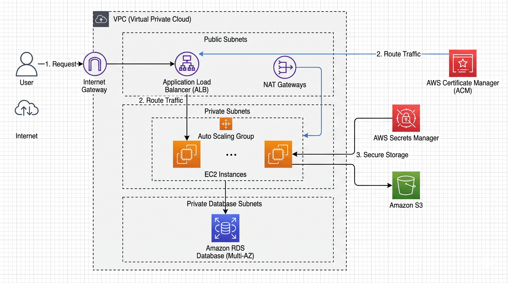

# Automated AWS Infrastructure & CI/CD


## 🌐 Live Application URL

👉 **[https://devops-task.theworkpc.com](https://devops-task.theworkpc.com)**

---

## 📌 Overview

This repository contains the complete, production-ready Infrastructure as Code (IaC) configuration to provision a highly available, secure, and resilient AWS environment. The infrastructure is entirely codified using **Terraform** and features a fully automated deployment lifecycle managed via a **GitHub Actions CI/CD pipeline**.

## 🏗️ AWS Architecture Diagram



### High-Level Traffic Flow

* **Application Traffic:** `Internet → Application Load Balancer (HTTPS) → Auto Scaling EC2 Instances (Private) → RDS MySQL (Private)`
* **Access Logging:** `Application Load Balancer → Amazon S3 (Access Logs Bucket)`

The deployment is architected for High Availability (HA), spanning across multiple Availability Zones in the `ap-south-1` region.

---

## 📂 Repository Structure

```text
.
├── .github/
│   └── workflows/
│       └── deploy.yml          # Automated CI/CD pipeline configuration
├── Screenshots/                # Deployment & verification screenshots
│   ├── 1-working-https-application.png
│   ├── 2-github-actions-pipeline.png
│   ├── 3-aws-ec2-instances.png
│   ├── 4-aws-rds-database.png
│   └── 5-dynu-dns-routing.png
├── scripts/
│   └── user_data.sh            # EC2 bootstrap script for Apache, PHP 8.2, and RDS connection
├── terraform/
│   ├── main.tf                 # VPC, Subnets, NAT, IGW, and S3 Storage configurations
│   ├── compute.tf              # Auto Scaling Group, Launch Template, and ALB
│   ├── database.tf             # Amazon RDS MySQL configuration with native Secrets Manager
│   ├── security.tf             # IAM Roles, Security Groups, and ACM Certificate
│   ├── backend.tf              # S3 Remote backend configuration
│   ├── outputs.tf              # Infrastructure outputs (ALB DNS, DB Endpoint)
│   └── variables.tf            # Input variables (region, domain name, etc.)
├── architecture_diagram.png    # High-level AWS architecture diagram
├── .gitignore                  # Git ignore rules for Terraform state and binaries
└── README.md                   # Project documentation
```

## ⚙️ Infrastructure Components

* **Networking & Topology:** Custom Amazon VPC distributed across 2 Public, 2 Private, and 2 Database Subnets across multiple Availability Zones. Outbound internet access for private resources is routed securely through a NAT Gateway.
* **Compute & Scaling:** Compute resources are managed via an EC2 Auto Scaling Group (ASG) utilizing `t3.micro` Amazon Linux 2 instances (min: 2, max: 4). Instances are bootstrapped dynamically using EC2 Launch Templates and `user_data.sh`, querying IMDSv2 for instance metadata.
* **Traffic Distribution:** An Application Load Balancer (ALB) serves as the single point of entry, enforcing HTTPS-only traffic and distributing load across healthy EC2 targets.
* **Data Layer:** Amazon RDS (MySQL 8.0) is deployed entirely within isolated private database subnets to ensure data is never exposed to the public internet.
* **Storage:** Amazon S3 buckets are provisioned with strict bucket policies for application artifact storage, centralized ALB access logging, and remote Terraform state management.
* **Security & Identity:** Native RDS AWS Secrets Manager integration is utilized for dynamic DB credential retrieval, enforced by least-privilege IAM Instance Profiles and chained Security Groups.

## 🔒 Security & Best Practices Implemented

* **Encryption in Transit:** The ALB terminates SSL/TLS (HTTPS via AWS Certificate Manager) at the edge and enforces a strict HTTP (Port 80) to HTTPS (Port 443) redirect.
* **Encryption at Rest:** Amazon RDS storage encryption (`storage_encrypted = true`) and S3 bucket encryption are enabled by default.
* **Secrets Management:** Database master credentials are natively managed and vaulted by AWS RDS in **AWS Secrets Manager** (`manage_master_user_password = true`), preventing password state drift. EC2 instances securely fetch these credentials at boot via an IAM Instance Profile while receiving the RDS endpoint via Terraform template injection—completely eliminating hardcoded credentials.
* **Least-Privilege IAM & SSM:** EC2 instances are attached to a custom IAM role granting scoped `secretsmanager:GetSecretValue` access only to the specific RDS secret ARN, scoped S3 bucket permissions, and `AmazonSSMManagedInstanceCore` for secure, keyless shell access via AWS Systems Manager.
* **Zero-Trust Networking:**
  * The **RDS Security Group** only accepts ingress connections on port `3306` from the  **EC2 Security Group** .
  * The **EC2 Security Group** only accepts ingress HTTP traffic on port `80` from the  **ALB Security Group** .
  * Direct SSH/Public access is disabled; all compute and database resources sit in private subnets.

## 🚀 CI/CD Pipeline (GitHub Actions)

Deployment is fully automated using a GitHub Actions workflow (`.github/workflows/deploy.yml`). The pipeline enforces code formatting, validates configuration syntax, generates deterministic execution plans, and applies infrastructure changes upon pushing to the `main` branch.

**Workflow Stages:**

1. **Source Checkout:** Retrieves the latest IaC configuration.
2. **Authentication:** Configures AWS credentials securely via GitHub Actions Secrets (`AWS_ACCESS_KEY_ID`,`AWS_SECRET_ACCESS_KEY`, and `AWS_REGION`).
3. **Initialization:** Runs `terraform init` to set up providers and initialize the S3 remote state backend.
4. **Validation:** Runs `terraform fmt -check` and `terraform validate` to enforce code formatting and structural integrity.
5. **Plan & Execution:** Executes `terraform plan` followed by `terraform apply -auto-approve` on pushes to `main`.

## 🛠️ Deployment Instructions & Manual DNS Intervention

Due to the utilization of a third-party Dynamic DNS provider ( **Dynu.com** ) instead of AWS Route 53, the automated deployment incorporates a deliberate manual intervention step for SSL certificate validation.

### Step-by-Step Deployment:

1. **Trigger the Pipeline:** Push or merge infrastructure changes to the `main` branch.
2. **ACM Validation Pause:** Terraform is configured with the `aws_acm_certificate_validation` resource. The GitHub Actions pipeline will intentionally "pause" and wait during the certificate request phase.
3. **DNS Configuration:**
   * Navigate to the AWS Certificate Manager (ACM) console.
   * Retrieve the generated `CNAME` records.
   * Add the `CNAME` record to the Dynu DNS control panel (ensuring no trailing dots).
4. **Automated Resumption:** Once AWS validates the CNAME, the certificate status will update to  **Issued** . The GitHub Actions pipeline will automatically detect this, resume the workflow, and finish provisioning the Load Balancer and Auto Scaling Group.
5. Final Routing: Retrieve the newly provisioned ALB IP address (via ping <alb-dns-name></alb>) and update the Dynu IPv4 root record to route live traffic to the application.

## 🧹 Infrastructure Teardown

To prevent ongoing AWS costs when the environment is no longer needed, the infrastructure can be safely destroyed via the GitHub Actions UI using the manual `workflow_dispatch` trigger.

1. Navigate to the **Actions** tab in this GitHub repository.
2. Select the **Terraform CI/CD** workflow on the left sidebar.
3. Click the **Run workflow** dropdown on the right side.
4. Type `yes` in the "destroy" input field.
5. Click the green **Run workflow** button to execute a clean `terraform destroy -auto-approve`.

*(Note: The S3 bucket holding the Terraform remote state must be manually emptied and deleted via the AWS Console after the teardown completes).*
